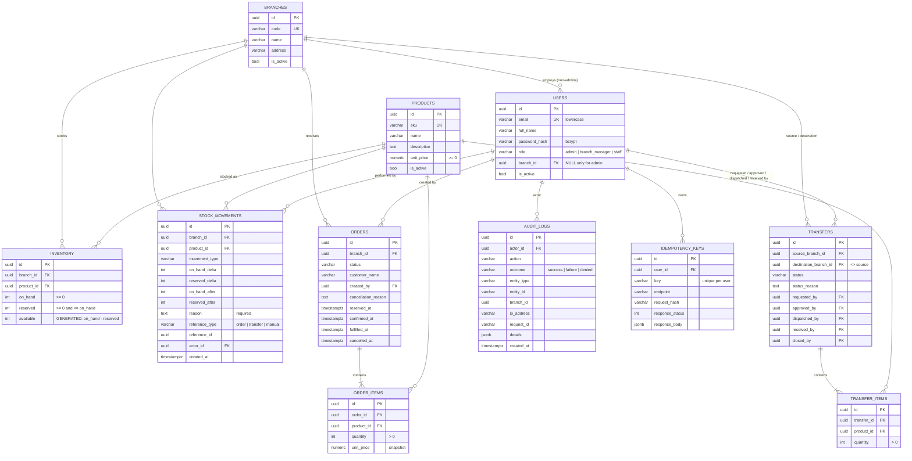

# Database schema

PostgreSQL (tested on 16 and 18). Created by the Alembic migrations in [`alembic/versions/`](../alembic/versions/):
`0001` creates every table, constraint, index and trigger; `0002` switches the ledger and audit
timestamps to `clock_timestamp()`. All primary keys are UUIDs. All timestamps are `timestamptz`.

## Entity–relationship diagram



## Tables at a glance

| Table | Purpose | Key integrity rules |
|---|---|---|
| `branches` | Shops / warehouses | `code` unique |
| `users` | People who log in | email unique and lowercase; admin ⇔ no branch |
| `products` | Shared catalogue | `sku` unique; price ≥ 0 |
| `inventory` | **Current** stock, one row per (branch, product) | unique (branch, product); `on_hand ≥ 0`; `0 ≤ reserved ≤ on_hand`; `available` is a generated column |
| `stock_movements` | **History** of every stock change (ledger) | append-only (trigger); reason required; must change something |
| `orders`, `order_items` | Customer orders | quantity > 0; one line per product per order; price snapshotted |
| `transfers`, `transfer_items` | Branch-to-branch stock moves | source ≠ destination; quantity > 0 |
| `audit_logs` | Security & change trail | append-only (trigger) |
| `idempotency_keys` | Safe retries | unique (user, key) |

## How the three stock numbers work

| Column | Meaning |
|---|---|
| `on_hand` | Units physically in the branch |
| `reserved` | Units promised to orders (or approved transfers) but not yet handed over |
| `available` | `on_hand − reserved`: what can still be promised. Computed by PostgreSQL, so it can never be stale. |

Because `reserved ≤ on_hand` is a CHECK constraint, **available can never be negative**,
even if application code has a bug. Concurrency safety is built on top of this
guarantee, not instead of it.

## Ledger rule

Every change to an `inventory` row writes exactly one `stock_movements` row **in the
same transaction**, recording the deltas and the resulting values. So:

- `SUM(on_hand_delta)` over a branch/product's movements equals its current `on_hand` (same for `reserved`).
- The ledger cannot be edited or deleted: a trigger raises an error on `UPDATE`/`DELETE`.
  Mistakes are fixed with a new, compensating movement, as in accounting.

## State machines

Implemented in [`order_service.py`](../app/services/order_service.py) (the `TRANSITIONS` table).
Any other move returns `409 invalid_transition` and changes nothing; repeating a move that already
happened returns the current state unchanged.

```
Orders:     pending ──► reserved ──► confirmed ──► fulfilled
               │            │             │
               └────────────┴─────────────┴──► cancelled   (releases reservation)
```

| Transition | Stock effect (all with a ledger entry referencing the order) |
|---|---|
| order reserve | `reserved += qty` (all lines or none) |
| order fulfil | `on_hand -= qty`, `reserved -= qty` |
| order cancel | `reserved -=` what the ledger says this order holds |
